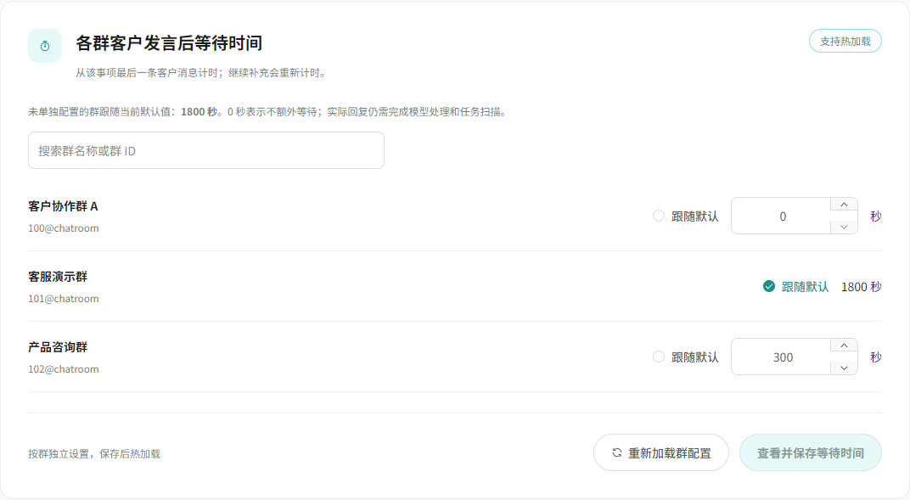
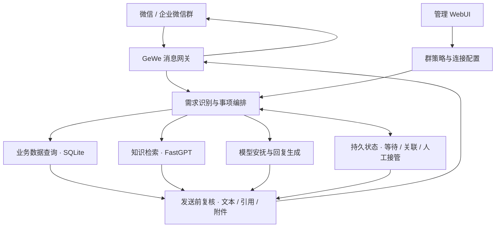

# AI Customer Service Agent

面向微信与企业微信群的通用客服 Agent，连接业务数据、知识库与人工服务。

接收文字、图片与引用消息，将客户的连续发言关联为可跟进的事项，结合业务数据和知识库组织回复。通过按群等待、人工接管与持久状态管理，让自动处理和真人服务在同一对话中协作，并提供 WebUI 配置、查询和观察运行情况。

**Python · FastAPI · SQLite · Vue 3 · TypeScript · FastGPT · GeWe**

[核心能力](#核心能力) · [管理后台](#管理后台) · [系统架构](#系统架构) · [快速开始](#快速开始) · [项目文档](#项目文档)

## 适用场景

- **业务资料查询**：检索业务记录、说明文档和相关附件，结合可核验的数据回复客户。
- **连续消息处理**：客户先发图片，再补充“这两份资料麻烦发一下”，系统将相关消息和图片关联到同一事项。
- **人工协作处理**：对于需要人工核实的业务问题，结合客户原话生成简短安抚，并按配置提醒负责人。
- **多群差异化运营**：不同客户群分别配置等待时间、客服名单、负责人和回复策略，也可先以影子模式观察。

## 核心能力

| 能力 | 实现方式 |
|---|---|
| 业务数据查询 | 查询本地 SQLite 业务读模型，关联记录与附件，核验结果后组织回复 |
| 知识库问答 | 通过 FastGPT 检索说明文档和常见问题，补充结构化数据之外的知识 |
| 多模态上下文 | 结合文字、图片与引用理解需求，按原消息绑定附件，隔离不同客户和独立事项 |
| 同事项关联 | 识别同一客户的说明与补充，统一计时，持久保存安抚回执，减少重复回复 |
| 人工接管 | 根据引用或上下文定位接管事项；控制状态跨重启保留，发送前再次核验 |
| 原生引用回复 | 逐群配置是否引用原问题；原消息元数据完整时生成微信引用气泡 |
| 简短安抚 | 使用原始需求及补充生成贴合事项的话术，也支持固定文案；约束未经核实的动作和时效承诺 |
| 按群等待 | 每群独立设置 0–86400 秒，或跟随运行中的默认值；群覆盖值保存后热加载 |

消息归档与需求创建分别处理：名片分享不会单独触发安抚，已撤回消息和人工已接管事项在调度、恢复与发送时继续受状态控制。

## 管理后台

内置 WebUI 统一管理群配置、回复策略和运行状态，无需日常直接编辑配置文件。

| 页面 | 可管理或查看的内容 |
|---|---|
| 群管理 | 群名单、启停与影子模式、负责人、客服身份、引用与事项关联开关 |
| 回复策略 | 各群等待时间、默认回复节奏、模型或固定安抚、路由阈值与负责人通知 |
| 模型与连接 | 对话模型、FastGPT、GeWe、飞书连接配置及连接测试 |
| 运行状态 | 服务与调度器、任务分布、最近异常、Docker/frpc、AidNet 及待重启配置 |
| 修改记录与恢复 | 保存记录、配置备份、差异预览与确认恢复 |
| 聊天记录 | 配置群的消息时间线、引用、附件，以及按角色、类型、关键词和日期筛选 |



*上图使用匿名模拟群和演示值，展示按群独立等待与继承默认值。*

保存配置前可预览差异；版本检查避免旧页面覆盖新修改。页面区分“已保存配置”和“当前运行值”，需要重启的变更会明确提示。使用方法见 [WebUI 说明](docs/群管理WebUI.md)。

## 系统架构



结构化业务事实通过本地数据库查询和核验，语义知识通过 FastGPT 检索。大模型参与需求理解、图片分析、事项判定与话术生成；等待、接管、撤回及发送回执由持久状态管理。

业务数据可通过飞书多维表格同步构建本地读模型。FastGPT 可使用本地容器或外部服务；模型通过 OpenAI 兼容接口接入，当前实现支持 DeepSeek 配置。

当前内置业务读模型包含商品、工厂、品类、商标与报告查询。用于其他业务时，需要适配相应的数据模型、同步映射与查询逻辑；消息编排、群策略和人工协作机制可作为复用基础。

## 快速开始

以下以 Windows PowerShell 为例，在项目根目录执行。生产部署、回调转发和服务账户配置见 [Windows 部署指南](快速部署指南-Windows服务器.md)。

### 1. 安装依赖

需要 Python 3.11–3.13、uv；首次构建管理页还需要 Node.js 22.12+ 与 pnpm 11。

```powershell
git clone https://github.com/LengXi-CS/AI-CustomerService.git
cd AI-CustomerService
uv sync --extra dev
powershell -NoProfile -ExecutionPolicy Bypass -File scripts/build_webui.ps1
```

### 2. 配置数据与接入

在项目根目录创建 `.env`，根据实际部署填写以下配置。完整字段及取值方式见 [配置项速查](docs/配置项速查.md)。

| 配置范围 | 主要内容 |
|---|---|
| 对话与图片模型 | `LLM_BASE_URL`、`LLM_API_KEY`、`LLM_MODEL`，以及按需配置的图片模型 |
| FastGPT | API 地址、应用密钥和知识库 ID |
| 微信接入 | GeWe 地址、Token、实例 ID、公网回调及媒体访问地址 |
| 本地存储 | 业务读模型、会话状态、媒体目录及持久保险库密钥 |
| 数据同步 | 使用飞书同步时填写应用和多维表格凭证，并准备业务数据 |

将 `config/wechat_groups.toml` 中的群名单、负责人和客服身份调整为自己的接入范围。按需同步业务数据、导入知识库，并在 GeWe 注册实际可达的回调地址。

### 3. 初始化后台并启动

```powershell
# 交互设置管理员密码
uv run python scripts/setup_admin.py

# 本地单进程启动
uv run uvicorn fastgpt_assistant.server.app:app --host 127.0.0.1 --port 5330
```

| 入口 | 地址 |
|---|---|
| 管理后台 | `http://127.0.0.1:5330/admin/` |
| 本地健康检查 | `GET /health` |
| 直接查询 | `POST /api/v1/query` |
| 微信回调 | `POST /api/wechat/callback` |

本地启动地址用于本机访问；公网回调需按实际网络配置转发。当前生产方式为单个 Uvicorn 进程，Windows 可通过 NSSM 托管。已有服务的更新使用 `scripts/restart_app.ps1`。

## 开发与验证

```powershell
# 运行回归测试
uv run pytest -q

# Python 静态检查
uv run ruff check src tests

# 前端类型检查与构建
powershell -NoProfile -ExecutionPolicy Bypass -File scripts/build_webui.ps1
```

2026-10-19 验证：**686 项测试通过**，Ruff 检查、前端类型检查与构建通过。回归覆盖人工接管、连续消息关联、按群等待、图片绑定、引用回复、名片过滤、撤回和重启恢复。现场部署与客户端验收范围见 [项目现状与验收](docs/项目现状与验收.md)。

## 项目文档

| 文档 | 内容 |
|---|---|
| [WebUI 使用说明](docs/群管理WebUI.md) | 后台启用、各页面操作、配置保存与恢复 |
| [配置项速查](docs/配置项速查.md) | 群策略、等待时间、路由和外部服务配置 |
| [Windows 部署指南](快速部署指南-Windows服务器.md) | 运行环境、服务托管、回调及排障 |
| [安抚话术生成](docs/安抚话术生成.md) | 原始需求输入、话术约束和名片处理 |
| [当天上下文与人工接管](docs/当天上下文与人工接管.md) | 上下文范围、接管判定及恢复机制 |
| [项目现状与验收](docs/项目现状与验收.md) | 当前实现、验证证据与现场核验要求 |
| [目录与归档](docs/目录与归档.md) | 代码目录、业务资料和历史文件位置 |
| [工程交接](交接文档.md) | 维护入口和后续核验事项 |
