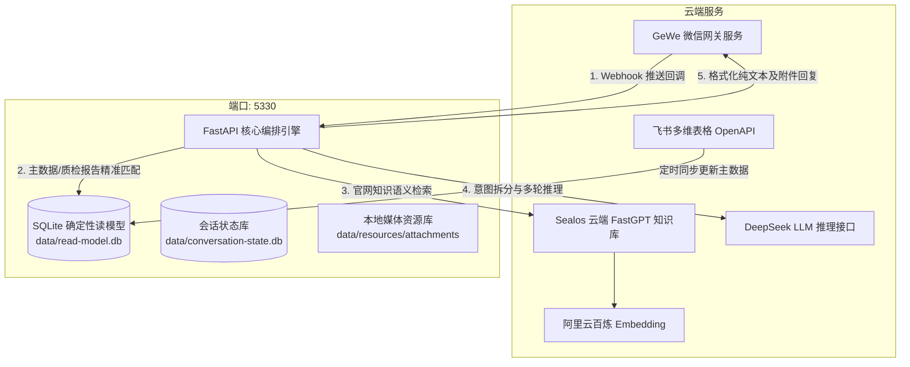

# FastGPT 微信智能客服助手 — Windows 服务器快速部署指南

本指南专为企业内网 Windows Server（2016 / 2019 / 2022 或 Windows 10/11 专业版/企业版）设计。
得益于 FastGPT 知识库已平移至 Sealos 云端，**当前服务器无需安装 Docker、WSL2 或复杂数据库容器**，只需轻量级的 Python 运行环境即可在 10 分钟内完成全套部署。

---

## 目录
- [一、部署架构概览](#一部署架构概览)
- [二、服务器前置环境准备](#二服务器前置环境准备)
- [三、代码拉取与依赖一键安装](#三代码拉取与依赖一键安装)
- [四、生产环境配置文件 (.env)](#四生产环境配置文件-env)
- [五、初始业务数据同步](#五初始业务数据同步)
- [六、服务启动与验证](#六服务启动与验证)
- [七、生产环境后台常驻与开机自启](#七生产环境后台常驻与开机自启)
- [八、日常运维与常见排错](#八日常运维与常见排错)

---

## 一、部署架构概览



---

## 二、服务器前置环境准备

### 1. 硬件与网络要求
* **硬件最低配置**：2 核 CPU / 4GB 内存 / 20GB 可用磁盘空间（轻量极简）。
* **网络连通性**：
  * 允许访问公网 HTTPS 端口（443）：包括 `https://fastgpt-uaqixmiy.sealosbja.site`、`https://api.deepseek.com`、`https://open.feishu.cn`。
  * 允许通过外网回调访问本服务器的 5330 端口（通过公司专线域名、公网 IP 端口映射或穿透工具）。

### 2. 软件安装
在服务器上打开 PowerShell（管理员权限）：

#### (1) 安装 Git
前往官网下载并安装 [Git for Windows](https://git-scm.com/download/win)。

#### (2) 安装 uv（现代高性能 Python 包管理器，强烈推荐）
在 PowerShell 中执行以下官方命令一键安装 `uv`（免去繁琐的 Python 环境变量配置）：
```powershell
powershell -ExecutionPolicy ByPass -c "irm https://astral.sh/uv/install.ps1 | iex"
```
> 安装后如果提示找不到 `uv`，重启 PowerShell 窗口即可。
> `uv` 会在安装项目依赖时**自动下载并隔离安装 Python 3.12**，无需手动配置系统 Python。

---

## 三、代码拉取与依赖一键安装

1. **获取代码**：
   在服务器上将代码放置于目标路径（例如 `C:\FastGpt`）：
   ```powershell
   git clone <你的Git仓库地址> C:\FastGpt
   cd C:\FastGpt
   ```

2. **一键同步创建虚拟环境与依赖**：
   ```powershell
   uv sync
   ```
   > 该命令会在 10~30 秒内自动下载 Python 3.12 并在根目录下创建 `.venv` 虚拟环境，完成全部依赖库的高速安装。

---

## 四、生产环境配置文件 (.env)

在项目根目录 `C:\FastGpt` 下创建或检查 `.env` 文件。请参照以下模板填写：

```ini
# ==========================================
# 1. 核心应用与服务端口
# ==========================================
APP_HOST=0.0.0.0
APP_PORT=5330
LOG_LEVEL=INFO

# ==========================================
# 2. FastGPT 云端知识库配置 (Sealos)
# ==========================================
FASTGPT_API_URL=https://fastgpt-uaqixmiy.sealosbja.site/api
FASTGPT_DATASET_ID=6aaf8a03ac9fc4a0427d159f
FASTGPT_API_KEY=fastgpt-ukWRETLZS4bUISZu7X1s5UVI57LxLu6cnYxLah3hYUZcfzLLJBCXOJYgXoPzqHI
FASTGPT_ROOT_KEY=fastgpt-ukWRETLZS4bUISZu7X1s5UVI57LxLu6cnYxLah3hYUZcfzLLJBCXOJYgXoPzqHI

# ==========================================
# 3. 核心 LLM 推理模型配置 (DeepSeek)
# ==========================================
EA_DEEPSEEK_API_KEY=sk-632cce4bb12e488c9537437808c52c41
EA_DEEPSEEK_BASE_URL=https://api.deepseek.com
EA_DEEPSEEK_CHAT_MODEL=deepseek-flash

# ==========================================
# 4. 微信接入网关配置 (GeWe)
# ==========================================
GEWE_BASE_URL=http://api.geweapi.com
GEWE_TOKEN=c3c3f67d-feda-43f3-8311-3c3b7596e308
GEWE_APP_ID=wx_VToOtGPg9rYXDS3pKKMCz
BOT_WXID=wxid_h6yzwq37fvs722

# 回调与多媒体外链公网访问根地址 (不要带末尾斜杠)
# 生产推荐使用公司域名，如：https://ai.yourcompany.com
PUBLIC_BASE_URL=http://1b75f2af.r11.cpolar.top
GEWE_PUBLIC_BASE_URL=http://1b75f2af.r11.cpolar.top
GEWE_CALLBACK_URL=http://1b75f2af.r11.cpolar.top/api/wechat/callback

# ==========================================
# 5. 飞书多维表格同步 (主数据读模型)
# ==========================================
EA_LARK_APP_ID=cli_aa1fa958b1b95d27
EA_LARK_APP_SECRET=CotQhZqlgTqzzeLuP2xVRdRwrPt3B0OO
EA_LARK_BITABLE_APP_TOKEN=BUmSbNGeVaVFyUsTQDMcGcLRnYd
EA_LARK_BITABLE_TABLE_ID=tbl0ap0h4IEqdlrM

# ==========================================
# 6. 本地数据与安全存储
# ==========================================
EA_READ_MODEL_DATABASE=data/read-model.db
EA_CONVERSATION_STATE_DB_PATH=data/conversation-state.db
EA_WECHAT_PAYLOAD_VAULT_KEY=MdXbx7mXc5DnYdqFaVpzqrQTBcLqjTHwu2g3zJUO5NM=
```

### 检查群聊策略配置 (`config/wechat_groups.toml`)
打开 `config/wechat_groups.toml`，确保你要激活的微信群 ID 已填入列表中，例如：
```toml
[global]
enabled = true
reply_to_staff_when_mentioned = true

[[groups]]
group_id = "49195424680@chatroom"
mode = "active"
require_customer_mention = false
allow_images = true
allow_files = true
owner_id = "wxid_2i863b4r6r3y22"
```

---

## 五、初始业务数据同步

首次部署或商品数据有更新时，需要从飞书多维表格拉取商品数据、工厂信息以及质检报告附件：

```powershell
# 从飞书全量同步商品表与附件至本地 SQLite
uv run python scripts/ops.py sync-bitable
```
*同步完成后，会自动生成 `data/read-model.db` 并下载附件到 `data/resources/attachments`。*

---

## 六、服务启动与验证

### 1. 前台调试启动
先在控制台前台启动，确认无任何报错：
```powershell
uv run python scripts/ops.py serve
```
出现 `Uvicorn running on http://0.0.0.0:5330` 及 `Application startup complete` 即表示服务启动成功。

### 2. 核心功能自测验证（在新的 PowerShell 窗口中执行）
```powershell
# 1. 验证基础健康检查 (应返回 status: healthy)
curl http://127.0.0.1:5330/health

# 2. 验证云端知识库问答
uv run python scripts/ops.py query "想买瀚思的产品，现在哪些平台有官方店？"

# 3. 验证本地主数据精确查表
uv run python scripts/ops.py query "查询商品 6976070461130 的信息与关联工厂"

# 4. 验证自动化单测全流程 (全绿灯通过)
uv run pytest tests/test_fastgpt_retrieval.py
```

---

## 七、生产环境后台常驻与开机自启

为了保证 Windows 服务器重启或注销登录后，AI 客服助手依然能在后台持续运行，推荐以下两种方式：

### 推荐方案 A：使用 NSSM 注册为 Windows 原生系统服务（最稳定、生产首选）

1. **下载 NSSM**：
   下载 [NSSM (Non-Sucking Service Manager)](https://nssm.cc/download)，将 `nssm.exe` 放置于 `C:\Windows\System32` 或项目根目录。
2. **注册服务**：
   在管理员权限 PowerShell 中执行：
   ```powershell
   # 注册服务名为 FastGptAssistant
   nssm install FastGptAssistant "C:\FastGpt\.venv\Scripts\python.exe" "-m uvicorn fastgpt_assistant.server.app:app --host 0.0.0.0 --port 5330"
   nssm set FastGptAssistant AppDirectory "C:\FastGpt"
   nssm set FastGptAssistant AppStdout "C:\FastGpt\logs\5330.out.log"
   nssm set FastGptAssistant AppStderr "C:\FastGpt\logs\5330.err.log"
   nssm set FastGptAssistant Start SERVICE_AUTO_START
   ```
3. **启动与管理**：
   ```powershell
   # 启动服务
   net start FastGptAssistant

   # 停止服务
   net stop FastGptAssistant

   # 查看服务状态
   sc query FastGptAssistant
   ```
   > 优势：Windows 开机无需登录账号自动启动、崩溃自动拉起、标准服务管理。

---

### 方案 B：使用 PowerShell 脚本后台启动

如果不需要注册为 Windows 服务，可以直接使用后台进程脚本：

**启动服务脚本 (`scripts/start_server.ps1`)**：
```powershell
# 确保 logs 目录存在
New-Item -ItemType Directory -Force -Path "logs" | Out-Null

# 杀掉可能占用的 5330 旧进程
Get-NetTCPConnection -LocalPort 5330 -State Listen -ErrorAction SilentlyContinue | ForEach-Object { Stop-Process -Id $_.OwningProcess -Force }

# 静默后台启动
Start-Process -FilePath ".\.venv\Scripts\python.exe" `
  -ArgumentList "-m","uvicorn","fastgpt_assistant.server.app:app","--host","0.0.0.0","--port","5330" `
  -WorkingDirectory (Get-Location) -WindowStyle Hidden -PassThru `
  -RedirectStandardOutput "logs\5330.out.log" -RedirectStandardError "logs\5330.err.log"

Write-Host "FastGPT Assistant 已在后台启动，端口: 5330"
```

**停止服务脚本 (`scripts/stop_server.ps1`)**：
```powershell
Get-NetTCPConnection -LocalPort 5330 -State Listen -ErrorAction SilentlyContinue | ForEach-Object {
    Stop-Process -Id $_.OwningProcess -Force
    Write-Host "已停止监听端口 5330 的进程 (PID: $($_.OwningProcess))"
}
```

---

## 八、日常运维与常见排错

### 1. 微信群内 @机器人 无响应
* **检查 1：GeWe 账号是否在线**
  在项目根目录运行单测或快速验证命令，确认 GeWe 登录态是否有效。
* **检查 2：回调地址是否可通**
  确保在 GeWe 控制台设置的回调地址能够被公网访问（例如通过浏览器访问 `https://<你的公网域名>/health` 应返回 `healthy`）。
* **检查 3：白名单限制**
  检查 `config/wechat_groups.toml` 是否已将当前群聊的 `group_id` 纳入配置。

### 2. 知识库检索失败或返回转人工
* 检查云端 FastGPT 服务是否可用，登录 `https://fastgpt-uaqixmiy.sealosbja.site` 确认服务运行正常。
* 检查 `.env` 中的 `FASTGPT_API_KEY` 是否有效。

### 3. 日志排查
所有运行时日志均输出至 `logs/` 目录：
* `logs/5330.out.log`：常规标准访问与查询调度日志
* `logs/5330.err.log`：错误与异常堆栈追踪
